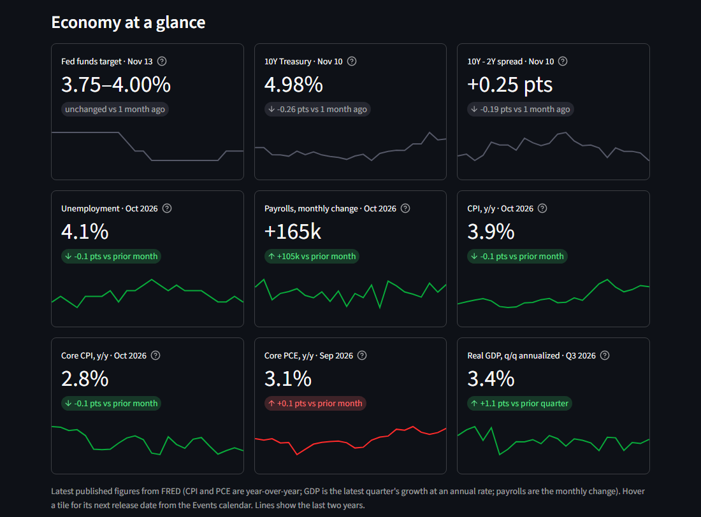
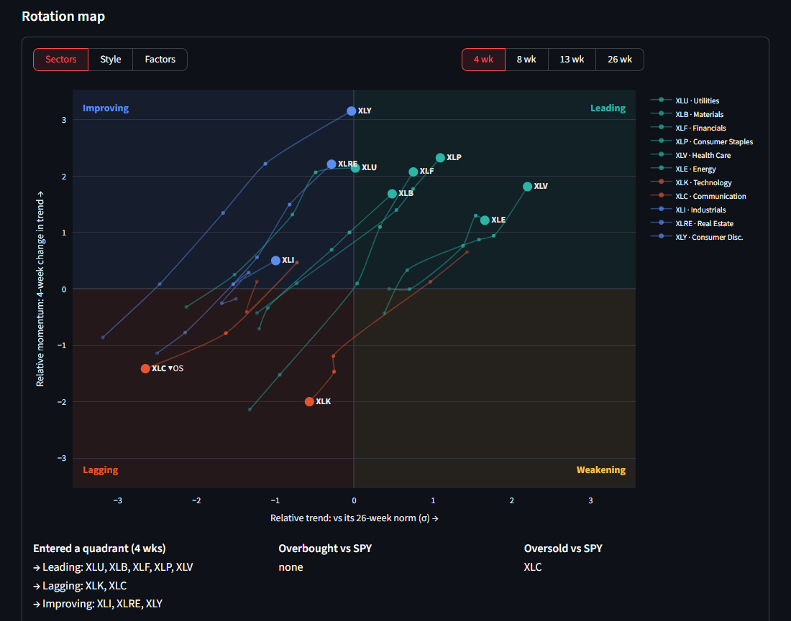
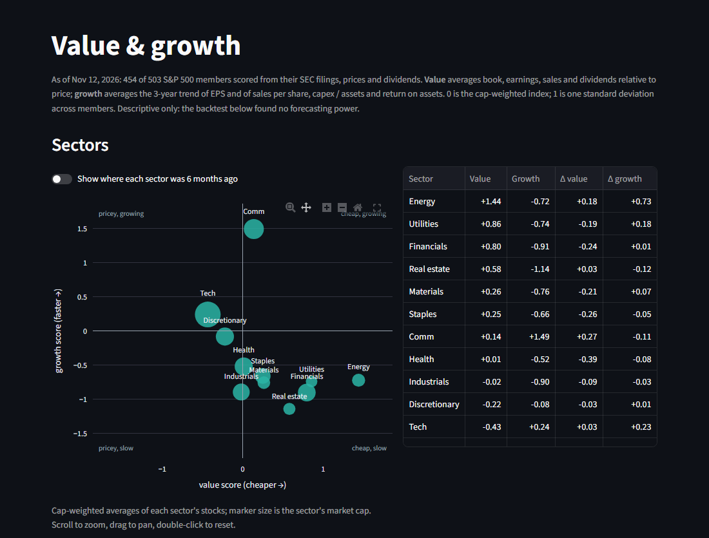
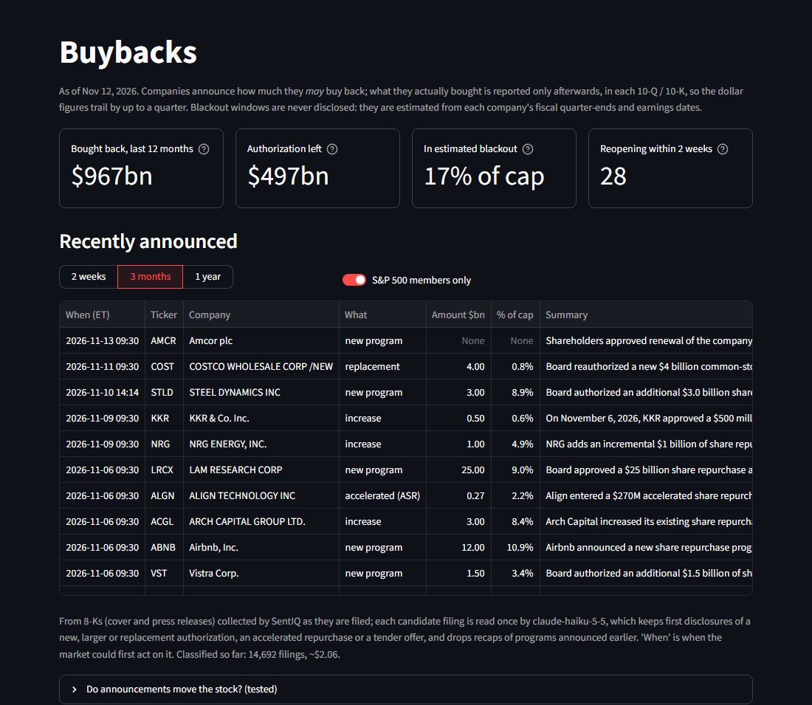

# Market Compass

**One Streamlit hub for market regime, breadth, credit, macro, volatility, tail-risk,
value/growth and buyback dashboards, plus an AI analyst that reads all of them and writes a
daily brief.**

Market Compass is two things:

- **Its own market dashboards.** Four regime gauges, the headline economic numbers, NYSE and
  S&P 500 breadth, style/sector/factor performance and rotation, global markets, a market
  map, a historical look-alike engine and a Claude-powered analyst.
  All of it is built from public data.
- **A home for seven companion projects.** Each companion is its own repository with its own
  models and dependencies. A nightly job runs each project's publish script with that
  project's own Python, and the hub shows the results on one page per project. A sidebar
  link opens each project's full app, starting it first if it isn't running.


> **Not investment advice.** These are personal research tools. Every page states what its
> numbers have and haven't been shown to do. Most say plainly that the gauges don't
> reliably predict next month's returns.

---

## Contents

- [What's in the hub](#whats-in-the-hub)
- [The companion projects](#the-companion-projects)
- [Quick start (hub only)](#quick-start-hub-only)
- [Full setup with all projects](#full-setup-with-all-projects)
- [Tour of the dashboards](#tour-of-the-dashboards)
- [How it works](#how-it-works)
- [Methodology](#methodology)
- [Configuration](#configuration)
- [Scheduling the nightly refresh](#scheduling-the-nightly-refresh)
- [Adding your own project](#adding-your-own-project)
- [Tests](#tests)
- [Repository layout](#repository-layout)
- [Limitations](#limitations)

---

## What's in the hub

| Page | Needs | What it shows |
|---|---|---|
| **Home** | - | Data freshness for every module, and everything registered with the hub |
| **Market Environment** | this repo | Fear/Greed, Liquidity, Technical and Economic regime gauges, each with a trend, a history chart against the S&P 500 and a measured link to next-period returns. Also the headline economic numbers (Fed funds, 10-year, curve, unemployment, payrolls, CPI, core PCE, GDP), NYSE-wide and S&P 500 breadth, a style/size grid, sector and factor tiles, a sector/style/factor rotation map with overbought/oversold readings vs SPY, a global markets table (about 57 ETFs: equities by region, bonds, commodities, currencies) and an S&P 500 / Nasdaq 100 market map. |
| **Look-alikes** | this repo | The 15 most similar past market states since 1997 and what the S&P 500 did next, with the method's own walk-forward track record |
| **Analyst** | this repo + Anthropic API key | A daily brief written by Claude from the hub's data, and a chat for follow-up questions |
| **Credit** | [credit-spread-analyzer](https://github.com/AndrewFSee/credit-spread-analyzer) | Credit-stress regime, spread forecast, rating tiers, CCC-B decompression, Fed liquidity |
| **Macro Regime** | [macro-regime-nowcaster](https://github.com/AndrewFSee/macro-regime-nowcaster) | Recession probability (point-in-time history since 1967), GDP nowcast, latent macro factors |
| **Volatility** | [stochastic-vol-surface](https://github.com/AndrewFSee/stochastic-vol-surface) | VIX family, implied vol by ticker (skew, term slope, variance risk premium), 21-day vol forecasts |
| **Tail Risk** | [tail-risk-scenario-engine](https://github.com/AndrewFSee/tail-risk-scenario-engine) | 21-day VaR/CVaR from 20,000 simulated paths, hedges, CVaR-optimal weights, stress scenarios |
| **Events & Odds** | [TickerLake](https://github.com/AndrewFSee/TickerLake) | The US release calendar with what Kalshi and Polymarket price for each number, the Fed path meeting by meeting, and index and single-stock prediction markets |
| **Risk Forecasts** | [augury](https://github.com/AndrewFSee/augury) | Per-ticker 1/5/21-day return distributions (VaR, ES, price ranges, forecast vol) for 28 ETFs and stocks, with a daily out-of-sample VaR track record since 2016 |
| **Value & Growth** | [TickerLake](https://github.com/AndrewFSee/TickerLake) | Value and growth scores for every S&P 500 member from its SEC filings, point in time: a zoomable sector map, sector history since 2012, a stock map and table, and the backtest |
| **Buybacks** | [TickerLake](https://github.com/AndrewFSee/TickerLake) + [SentIQ](https://github.com/AndrewFSee/sentiq) (+ Anthropic API key) | Buyback announcements from 8-Ks as they are filed, classified by Claude; each member's buybacks, buyback yield and remaining authorization; the estimated share of the index in its buyback blackout, with windows reopening soon |

The first three pages work with this repository alone. Each companion page reads what
its project published. If a project isn't installed, its page says there's no data yet
and the rest of the hub carries on.

## The companion projects

To get the full hub, **clone the seven companion repositories next to this one**, each
with its own virtual environment. They are independent projects with their own READMEs,
tests and apps. The hub only needs each one's publish script (`scripts/publish_to_hub.py`,
or `scripts/publish_<what>_to_hub.py` where one project feeds several pages).

| Project | What it adds to the hub | Notes |
|---|---|---|
| [**credit-spread-analyzer**](https://github.com/AndrewFSee/credit-spread-analyzer) | `data/credit/`: spreads (bps and % points), real-time stress-regime probability, overlay equity weight, rating-tier history, 5-day spread forecast | Runs first, because the market gauges use its high-yield spread history. No API key needed. FRED serves only about 3 years of the ICE BofA OAS series; you can splice a longer licensed history in yourself (see that project's README). |
| [**macro-regime-nowcaster**](https://github.com/AndrewFSee/macro-regime-nowcaster) | `data/macro/`: the live nowcast and its walk-forward (point-in-time) recession history | Needs `FRED_API_KEY`. The history panel (`data/features.csv`) isn't in that repo: build it once with `python scripts/build_features.py --start 1967-01-31`, which is slow (one refit per month, about 3 hours). After that the hub's monthly task rebuilds it (see *Scheduling*). The page warns when it's more than 45 days old. |
| [**stochastic-vol-surface**](https://github.com/AndrewFSee/stochastic-vol-surface) | `data/vol/`: surface features per ticker, VIX/MOVE/OVX history, forecasts with outcomes | Its publisher makes no network calls. It reads what the project's own daily option-chain scraper collected, so run that scraper on a schedule (see its README). The page flags missed sessions. |
| [**tail-risk-scenario-engine**](https://github.com/AndrewFSee/tail-risk-scenario-engine) | `data/tailrisk/`: return fan, P&L histogram, VaR/CVaR, hedges, optimiser, stress scenarios | The portfolio and scenarios come from its `configs/default.yaml` and `configs/scenarios/`. |
| [**augury**](https://github.com/AndrewFSee/augury) | `data/augury/`: forecast table, 21-day price bands, recent prices, every past forecast with its outcome, track-record scores | Downloads prices from Yahoo. The first run scores every day since 2016 for 28 tickers (about 7 minutes); after that it recomputes only the last few weeks (under a minute). |
| [**TickerLake**](https://github.com/AndrewFSee/TickerLake) | `data/revisions/`: sector EPS-estimate revisions and analyst rating actions | A data lake with its own daily scheduled run; its `analyst` stage snapshots Yahoo's consensus for every S&P 500 member. Its publishers read only the lake. Yahoo keeps no estimate history, so the history starts when you start collecting. |
| [**TickerLake**](https://github.com/AndrewFSee/TickerLake) (same repo) | `data/breadth/`: NYSE-wide breadth; `data/events/`: release calendar and prediction-market odds | Its `listings` and `listed_ohlcv` stages keep daily bars for every NYSE common stock (one-time `tickerlake backfill listed_ohlcv`, about 13 minutes). `econ_calendar` (needs a FRED key) and `prediction_markets` (Kalshi and Polymarket, no keys) snapshot the calendar and odds daily. |
| [**TickerLake**](https://github.com/AndrewFSee/TickerLake) (same repo) | `data/style/`: value and growth scores; `data/buybacks/`: repurchases, authorizations and estimated blackout windows | Both read its `filings_facts` (SEC company facts). Buyback windows need each quarter's earnings-release date: run `python scripts/backfill_earnings_releases.py` once (about 4 minutes; it reads SEC filing indexes). |
| [**SentIQ**](https://github.com/AndrewFSee/sentiq) | `data/buyback_news/`: candidate buyback passages from 8-Ks | A news and filings collector that polls EDGAR every 2 minutes. Its publisher only reads what SentIQ already stored, so the hub never fetches from the SEC itself. The hub's own job then has Claude Haiku read each candidate once (about $0.0003 a filing). |

## Quick start (hub only)

Developed and tested on Python 3.13.

```bash
git clone https://github.com/AndrewFSee/market-compass.git
cd market-compass
python -m venv .venv
source .venv/bin/activate              # Windows: .venv\Scripts\activate
pip install -r requirements.txt
cp .env.example .env                   # add FRED_API_KEY (free), optionally ANTHROPIC_API_KEY

python run_jobs.py --demo              # synthetic data, no network: see it working right away
streamlit run app.py                   # http://localhost:8501

python run_jobs.py                     # real data
```

`--demo` fills every hub-owned page with synthetic data. The first real run takes a few
minutes. It pulls 5 years of prices for about 500 S&P 500 members and 45 ETFs, 2 years for
the 57 global-markets ETFs, full SPY and VIX history, about 35 FRED series and market caps. Later runs reuse cached market caps
for a week.

## Full setup with all projects

**1. Clone everything into one parent folder.** The hub looks for the projects next to
itself:

```
projects/
├── market-compass/                 <- this repo
├── credit-spread-analyzer/
├── macro-regime-nowcaster/
├── stochastic-vol-surface/
├── tail-risk-scenario-engine/
├── augury/
├── TickerLake/
└── SentIQ/
```

```bash
cd projects
git clone https://github.com/AndrewFSee/market-compass.git
git clone https://github.com/AndrewFSee/credit-spread-analyzer.git
git clone https://github.com/AndrewFSee/macro-regime-nowcaster.git
git clone https://github.com/AndrewFSee/stochastic-vol-surface.git
git clone https://github.com/AndrewFSee/tail-risk-scenario-engine.git
git clone https://github.com/AndrewFSee/augury.git
git clone https://github.com/AndrewFSee/TickerLake.git
git clone https://github.com/AndrewFSee/sentiq.git SentIQ
```

A project cloned one level deeper (`macro-regime-nowcaster/macro-regime-nowcaster/`) is
found too. To keep the projects somewhere else, set `HUB_PROJECTS_DIR` to their parent
folder.

**2. Give each project its own `.venv` inside its folder.** The hub runs
`<project>/.venv/Scripts/python.exe` (Windows) or `<project>/.venv/bin/python`, so the
dependencies never mix. Install each one as its README describes:

```bash
cd credit-spread-analyzer    && python -m venv .venv && .venv/bin/pip install -r requirements.txt && cd ..
cd macro-regime-nowcaster    && python -m venv .venv && .venv/bin/pip install -e ".[dev]" && cd ..
cd stochastic-vol-surface    && python -m venv .venv && .venv/bin/pip install -r requirements.lock && .venv/bin/pip install -e . --no-deps && cd ..
cd tail-risk-scenario-engine && python -m venv .venv && .venv/bin/pip install -e ".[app,dev]" && cd ..
```

(On Windows use `.venv\Scripts\pip`.) augury, TickerLake and SentIQ are set up as their own
READMEs describe; each still needs its `.venv` inside its folder.

**3. Do each project's one-time data setup.** Build the macro panel
(`python scripts/build_features.py` in macro-regime-nowcaster). Run the vol scraper once
and schedule it (`python scripts/schedule_scraper.py --once`; its README covers the
backfills).

**4. Put your keys in the hub's `.env`.** `run_jobs.py` passes its environment on to every
publish script, so one `FRED_API_KEY` serves the hub and the macro project.

**5. Refresh and run:**

```bash
cd market-compass
python run_jobs.py                     # every job in registry.JOBS order (below)
streamlit run app.py
```

The order is credit → breadth → market → analogs → macro → vol → tailrisk → augury →
revisions → events → style → buybacks → buyback_news → buyback_news_classify → analyst.
A project that isn't cloned, or has no `.venv`, is skipped with a one-line note instead
of failing the run. `python run_jobs.py --only market credit` runs a subset.

**6. The full apps.** The sidebar's *Other dashboards* links open each project's own
Streamlit app (ports 8502-8506). A link to an app that isn't running starts it with that
project's venv, waits for it and then forwards you. `python start_apps.py` starts the hub
and all five apps at once (`--status`, `--stop`); their logs go to `data/logs/apps/`.

---

## Tour of the dashboards

### Market Environment

**Four regime gauges** (screenshot at the top). Each card shows:

- the reading and its band;
- whether it's rising or falling against 1 week and 1 month ago (1 and 3 months for the
  monthly economic gauge);
- a *Components* table;
- a *History vs S&P 500* chart.

**Gauges vs the S&P 500** measures each gauge two ways:

- How it moves *with* the market: the coincident correlation.
- Whether it says anything about the *next* period: a rank correlation on
  non-overlapping periods, using each reading only from the day it could have been
  published.

The verdict column applies a significance test, and the tabs break next-period returns
down by gauge band. Currently none of the four passes. The page says so rather than
implying a signal.


**Economy at a glance.** Nine tiles with the latest published figure from FRED: the Fed funds
target range, the 10-year yield, the 10-year minus 2-year spread, unemployment, the monthly
change in payrolls, CPI, core CPI and core PCE year over year, and real GDP growth at an
annual rate. Each tile shows:

- the change against a month earlier (daily series) or the prior release;
- two years of history;
- the next release date, from the Events calendar (hover the tile).



**Breadth, style and sectors.** The breadth panel covers either all NYSE common stocks
(about 2,200, from TickerLake) or the S&P 500 members:

- advancing vs declining stocks, with a cumulative A/D line;
- the share of members above their 20-, 50- and 200-day averages;
- new 52-week highs and lows.

Next to it are a large/mid/small × value/core/growth grid and tiles for the 11 sector ETFs
and 22 factor ETFs. Each tile has 1-day to 2-year returns, coloured as leading, flat or
lagging relative to SPY.


**Rotation map.** This shows where each sector, style or factor ETF is in its strength cycle
against SPY, on weekly closes:

- **Across:** relative strength compared with its own 26-week norm.
- **Up:** how fast that reading changed over the last 4 weeks.

Tails show the last 4 to 26 weeks. Strength tends to cycle clockwise:
Improving → Leading → Weakening → Lagging. ETFs whose RSI on the ETF/SPY ratio is ≥ 70 or
≤ 30 are tagged overbought or oversold vs SPY. Below the map are:

- the ETFs that entered a new quadrant in the last 4 weeks;
- a table sorted clockwise around the map;
- an expander that tests the whole approach on full history (see
  [Methodology](#rotation-map)).



**Sector internals.** These panels check whether a rotation is broad or rests on a few names.

- **One row per sector** (the S&P 500 members behind each sector ETF):
  - the share of members beating SPY over 4 weeks;
  - the share above their 50- and 200-day averages;
  - net new 52-week highs;
  - equal-weighted minus cap-weighted return;
  - a check of whether participation agrees with the rotation map's direction.
- **What's driving it:** pick a sector to see each company's contribution to its move vs SPY
  over 1, 4 or 13 weeks, plus a year of participation history.
- **Leadership:** a heatmap of every sector's 4-week return vs SPY, week by week, with how
  spread out and how correlated the sectors are now compared with history.
- **Cross-asset checks:** each sector against the driver that should move it:
  - financials vs the yield curve;
  - energy vs crude oil;
  - materials vs copper/gold;
  - utilities and real estate vs the 10-year yield;
  - cyclicals vs defensives against the high-yield spread.

  The table shows whether the latest moves agree and how strong the link has been, both
  recently and historically.
- **Fund flows:** money moving into and out of each sector SPDR over 1, 4 and 13 weeks, in
  dollars and as a share of the fund's assets, against the fund's own history. Flows are the
  daily change in shares outstanding × NAV, from State Street's free NAV-history files.
- **Estimate revisions & analyst actions** (from TickerLake), for each sector:
  - the median 30- and 90-day change in next fiscal year's EPS estimate;
  - the balance of analysts' upward and downward revisions;
  - upgrades, downgrades and price-target changes over the last 30 days;
  - the companies with the biggest revisions.

**Global markets.** About 57 US-listed ETFs grouped as equities by region and country,
bonds, commodities, and currencies and bitcoin. A bar chart ranks the chosen group over the
chosen period. The table gives for each one:

- returns over 1 day, month to date, year to date and 1 year;
- where the price sits in its 52-week range;
- its distance from the 200-day average and that average's direction;
- RSI(14) and a weekly sparkline.

**Market map.** An S&P 500 or Nasdaq 100 treemap, sized by market cap and coloured by
return over the chosen period. Click a sector to zoom in.


### Credit

From credit-spread-analyzer:

- the real-time credit-stress regime (a 3-state HMM on the Baa spread, refitted each
  January on past data only);
- the equity weight of its validated volatility/credit overlay;
- a 5-day Baa spread forecast;
- the ICE spreads;
- rating-tier percentiles and the CCC-B gap, which widens when the weakest credits crack
  first;
- Fed net liquidity (balance sheet - Treasury General Account - reverse repo).


### Macro Regime

From macro-regime-nowcaster:

- the ensemble recession probability, as it read at the time (one refit per month,
  keeping only that fit's final row, so no point uses later data), with NBER recessions
  shaded;
- the signals behind it, with their out-of-sample weights;
- the GDP nowcast with its interval;
- the latest Kalman-filtered factors.


### Volatility

From stochastic-vol-surface:

- the VIX family, MOVE and OVX;
- a table of 30-day ATM implied vol, its 1-year percentile, 25-delta risk reversal,
  30-to-91-day term slope, variance risk premium and the 21-day forecast with an 80% band
  for each ticker;
- implied vs realised vol and the ATM term structure for any ticker.


### Look-alikes

The page compares today's market state with every trading day since 1997 and finds the 15
closest distinct episodes. The state covers trend, momentum, VIX, the VIX trend, the
high-yield spread and its change, the liquidity gauge and the yield curve.

It then shows what the S&P 500 did over the following 3 months, against the same
figures for all days. The *Does this method work?* panel holds the walk-forward test:
**no skill on direction** (rank correlation -0.03 over 297 months), but useful for
**volatility** (0.48, adding 0.21 beyond "last month's vol continues").


### Analyst

Every evening, after the data refresh, Claude (`claude-opus-5-5`) writes a brief from the
hub's own data. It covers what changed, what stands out, the look-alikes, the risk for the
coming month and what to watch. It calls nine read-only tools over the published data, so
every figure traces back to a page, and the brief notes which inputs are stale.

The page keeps 60 days of briefs. A chat below answers follow-up questions live with the
same tools and shows the tokens each answer used. A brief costs roughly $0.15 to $0.20 in
API usage. Without `ANTHROPIC_API_KEY`, the job is skipped and the rest of the hub is
unaffected.


### Tail Risk

From tail-risk-scenario-engine. The engine fits GARCH-t margins and a Student-t copula to
standardized residuals, with a two-state regime model that starts from today's crisis
probability. It simulates 20,000 21-day paths for the configured portfolio.

The page shows:

- VaR and CVaR against the same measures from history;
- the return distribution and path fan;
- hedges (SPY puts priced with Black-Scholes at the current VIX, and an inverse ETF) on
  the same scenarios;
- CVaR-optimal weights;
- historical and parametric stress scenarios.


### Risk Forecasts

From augury. Each ticker gets GJR-GARCH with skewed-t shocks fitted on its last two years;
SPY, QQQ, IWM, TLT and GLD also blend in their implied-vol index (VIX, VXN, MOVE, GVZ),
the only assets where that was shown to help. The page shows:

- a table of 1-day 99% VaR, 1-day and 21-day 90% ranges, 5-day 95% VaR and forecast vs
  realised vol for 28 ETFs and stocks, with each one's VaR breaches over the last 250
  sessions and Basel zone;
- a fan chart and VaR / expected shortfall at 1, 5 and 21 days for any ticker;
- that ticker's track record: every day since 2016, the forecast made the night before
  against the return that followed, with breach counts, Kupiec and Christoffersen tests,
  interval hit rates and the implied-vol view's skill against plain GJR.

The Volatility page forecasts the level of 21-day vol; this one forecasts the whole return
distribution at short horizons, so the two complement each other.

### Events & Odds

From TickerLake. The economic calendar lists the next three weeks of US releases (FRED's
release calendar, curated; FOMC and ISM dates from Kalshi) with what the prediction markets
price for each number:

- **Kalshi ladders** ("CPI above 0.2%", "above 0.3%", ...) give an implied median, the
  level with even odds of being exceeded, and a chart of the whole ladder;
- **named outcomes** (Fed decisions, Polymarket's buckets) give each outcome's probability;
- **the Fed path:** P(cut / hold / hike) at every meeting on both venues;
- **indices and stocks:** Kalshi's S&P 500 and Nasdaq-100 ranges, and Polymarket's
  close-above and touch ladders for SPY and about 20 stocks, against the last close.

Odds are snapshotted daily, so each release's implied median gets a history. These are the
markets' prices, not forecasts the dashboard has tested.

### Value & Growth

From TickerLake. Every S&P 500 member gets two scores from its own SEC filings, prices and
dividends:

- **Value** averages book, trailing earnings, sales and dividends relative to price.
- **Growth** averages the 3-year trend of EPS and of sales per share, capex / assets and
  return on assets.

0 is the cap-weighted index, and 1 is one standard deviation across members. The page shows
a sector map (where each sector was 6 months ago, optionally), each sector's history since
2012, and a stock map and table you can filter by sector. Both maps zoom with the scroll
wheel and pan by dragging.

The page calls itself descriptive because the backtest found nothing to trade on (see
[Methodology](#value-and-growth-scores)).



### Buybacks

From TickerLake and SentIQ:

- **Recently announced.** New, larger or replacement buyback authorizations, accelerated
  repurchases and tender offers, found in 8-Ks as they are filed. Each row has the amount,
  the amount as a share of market cap, a one-line summary and a link to the filing.
- **The members.** Each one's buybacks over the last quarter and year, buyback yield,
  one-year change in share count, authorization left, and recent announcements.
- **The blackout.** Companies usually stop buying back shortly before each quarter's end
  until just after they report. The windows aren't disclosed, so the page estimates them
  from each company's fiscal calendar and release dates, and charts the share of the index
  (by count and by market cap) in its window, from 2010 to 90 days ahead. It also lists the windows
  reopening in the next two weeks.

Expanders on the page state what the announcement and blackout tests found (see
[Methodology](#buybacks-1)).



### Home

Data freshness for every module, and everything registered with the hub.


---

## How it works

**Jobs compute, pages display.**

- A *job* fetches data, computes, and saves its results into `data/<module>/` (Parquet
  tables and JSON) with `core.store.save_frame` / `save_json`.
- A *page* only reads them, through a cache keyed on each file's modification time.

So the dashboard loads instantly, a failed refresh leaves the previous numbers in place,
and any page can reuse another module's data. The Analyst chat is the one deliberate
exception: it calls the API from the page.

```
run_jobs.py ──┬─ credit    {credit-spread-analyzer/.venv}  scripts/publish_to_hub.py ─┐
              ├─ market    modules/market/job.py   (FRED, Yahoo, Wikipedia)          │
              ├─ analogs   modules/analogs/job.py  (reads market + credit)           ├──> data/<module>/*.parquet, *.json
              ├─ macro     {macro-regime-nowcaster/.venv}  publish_to_hub.py         │         │
              ├─ vol       {stochastic-vol-surface/.venv}  publish_to_hub.py         │         v
              ├─ tailrisk  {tail-risk-scenario-engine/.venv} publish_to_hub.py       │   app.py (Streamlit) -> pages read only
              ├─ augury    {augury/.venv}  publish_to_hub.py                         │
              ├─ breadth, revisions, events, style, buybacks                         │
              │            {TickerLake/.venv}  scripts/publish_*_to_hub.py           │
              ├─ buyback_news           {SentIQ/.venv}  publish_buyback_candidates   │
              ├─ buyback_news_classify  modules/buybacks/news.py  (Claude Haiku)     │
              └─ analyst   modules/analyst/job.py  (Claude + read-only tools) ───────┘
```

**`registry.py` is the one place to register things.**

- `PAGES`: the sidebar.
- `LINKS`: the full apps, with a launch command each.
- `JOBS`: the refresh, in order.

A job is either `"module:function"`, called in the hub's Python as
`fn(demo=bool, log=callable)`, or `{"cmd": [...], "cwd": ...}`: another project's script,
run with that project's interpreter.

**The publisher contract.** For an external job, `run_jobs.py` sets three things in the
child's environment:

- `HUB_DATA_DIR`, where to write;
- the hub's folder on `PYTHONPATH`, so the child can `from core import store` without the
  hub needing the child's dependencies (or the child the hub's);
- `--demo`, when the hub itself runs with `--demo`.

Publishers stay thin. They call each project's own validated functions and never
re-implement them.

**Operational details:**

- `run_jobs.py` holds `data/jobs.lock`, so a scheduled and a manual refresh can't overlap.
- Each job's output goes to `data/logs/jobs.log`.
- One failing job doesn't stop the others.
- Market prices are cut to the last *complete* session, because Yahoo sometimes serves
  today's row half-filled after the close.

## Methodology

### Regime gauges

All recipes live in `modules/market/config.py` and the pure-pandas
`modules/market/indicators.py`.

| Gauge | Scale | Method |
|---|---|---|
| **Fear / Greed** | 0 to 100 | Six components, each ranked against its trailing 2 years: S&P 500 vs its 125-day average, net new 52-week highs, % of members above their 50-day average, VIX vs its 50-day average (inverted), stocks minus bonds over 20 days, and HY minus IG spread (inverted). |
| **Technical** | 0 to 100 | S&P 500 RSI(14), stochastic(14), MACD histogram, and distance from the 50- and 200-day averages, ranked against the trailing 2 years. |
| **Liquidity** | -100 to +100 | Eight factors, each z-scored against its trailing 3 years and signed so that higher means looser: HY and IG spreads, 3-month change in the 2-year yield, 10-year real yield, Fed net liquidity, bank reserves, the broad dollar, and the Chicago Fed NFCI. |
| **Economic** | -100 to +100 | Sixteen monthly leading indicators. Each one's 6-month change is z-scored and weighted by its historical correlation with real GDP growth 6 months later. The gauge shows the latest month in which at least 75% of the indicators have reported; later months are marked provisional. |

**Trend** compares each reading with 1 week and 1 month ago. **vs S&P 500**:

- *Coincident*: correlation of the gauge's change with the S&P 500's return over the same period.
- *Next period*: Spearman rank correlation between the reading and the following
  1-month (economic: 3-month) return.
  - It uses non-overlapping periods, so the period count is the real sample size.
  - Each reading is used only after its publication lag: 1 day for FRED daily series,
    up to a week for weekly series, a month for monthly data.
  - A link counts as reliable when |ρ|·√(n−1) > 1.96.

**Breadth.** The breadth panel defaults to every NYSE common stock (about 2,200, from
TickerLake's daily bars). It uses dividend-adjusted closes, because raw closes understate
breadth for high-payout closed-end funds, REITs and MLPs. The gauges still use S&P 500
member breadth, which has the longer history.

### Rotation map

The rotation map is the hub's own relative-rotation view, not the proprietary JdK RS-Ratio
formula. Everything is calculated on weekly closes of the ETF / SPY ratio:

- **Trend:** the log ratio minus its 26-week average, in standard deviations of that gap
  over the last 52 weeks.
- **Momentum:** the change in trend over 4 weeks.
- **Overbought / oversold:** a 14-week RSI of the ratio.

The job downloads each ETF's full history and checks the map on non-overlapping 4-week
periods. Results are reported separately for before and after 2015, measured against the
group's average:

- **Candidate measures.** Eight are compared (10/26/52-week trend, 4/13/52-week relative
  return, 12-month-ex-last-month momentum, relative RSI). Each is scored by its
  cross-sectional rank correlation with the next 4 weeks' relative return.
- **Quadrants and rotation.** The page shows the next-4-week return for each quadrant, how
  often ETFs move clockwise vs counter-clockwise, and what followed overbought and
  oversold readings.

On 1999–2026 data:

- **No measure forecasts reliably.** The best, 12-month-ex-last-month momentum, has rank
  correlations of +0.03 to +0.08 with t ≤ 2, and even those don't hold for every group.
- **Leading didn't keep leading.** For sectors, Leading beat the group before 2015 and
  trailed it since.
- **Clockwise motion is partly arithmetic.** It is about 2.4× as common as
  counter-clockwise, but momentum is the change in trend, so any swing traces a clockwise
  loop.
- **Overbought sectors gave something back.** The most consistent finding: a sector with
  relative RSI ≥ 70 trailed the other sectors by about 0.4% over the next 4 weeks in both
  periods. It fell 55% of the time.

26-week trend with 4-week momentum was picked for readability: it rotated cleanly without
the zig-zag of shorter windows.

### Sector internals and cross-asset checks

- **Membership and weights.** Members come from the S&P 500 list, mapped to the sector ETFs
  by GICS sector. Weights are today's market caps with the share count held fixed, so they
  approximate each ETF's holdings.
- **Contributions.** A member's contribution is its weight at the start of the window ×
  (its return − SPY's return). Within a sector they add up to the members' cap-weighted
  move vs SPY.
- **Participation test.** Every 4 weeks, each sector is sorted by the rotation map's
  momentum (rising or falling) and by participation (50% of members beating SPY). The page
  shows its return vs the other sectors over the next 4 weeks. The sample is only the five
  years of member prices, and uses today's members. On real data, ranking sectors by
  participation had a rank correlation of +0.055 (t 1.3) with the next 4 weeks.
  Participation didn't confirm falling sectors: the falling ones that still had broad
  participation did worst.
- **Cross-asset links.** The link is the correlation of weekly changes since about 1999,
  signed so that positive means moving the expected way:
  - oil and energy: +0.58;
  - the high-yield spread and offense/defense: +0.42;
  - the 10-year yield with real estate: +0.38, and with utilities: +0.28;
  - the yield curve and financials: +0.17;
  - copper/gold and materials: +0.14.

  The page shows the last 52 weeks next to the full history, because these links come
  and go.
- **Fund flows** (since 2004). How the flows are cleaned:
  - share splits, each fund's first quarter and XLRE's 2016 spin-off from XLF are left out;
  - signals use flows through the day before, since each file is published the next morning.

  Ranking sectors by 4- or 13-week flows didn't line up with the next 4 weeks in either half
  of the history (rank correlations −0.04 to +0.005). 13-week flows looked contrarian before
  2015 (t −2.2), but not after.
- **Analyst rating changes.** These were backtested in TickerLake on 154k events from
  2012-2026 (`scripts/backtest_analyst_ratings.py`). Prices move at the announcement
  (upgrades +1.2%, downgrades −1.7%) before you could trade at the next open. What follows
  is too small to beat trading costs. Price-target raises minus cuts were statistically
  clear only after 2019.

### Value and growth scores

The method lives in TickerLake (`tickerlake.analytics.style`), built on CRSP-style factor
definitions:

- **Point in time.** Each fact is used from the day after it was first filed. A quarter
  counts only once every input it uses has been filed: about a fifth of quarters had an input
  (often total assets or cash flow) first filed later, as a comparative in the next report.
- **Factors.** Quarterly flows come from 3-month facts or differenced year-to-date facts.
  Share counts are put on today's split basis. Each factor is clipped at the 2.5th and 97.5th
  percentiles and z-scored against the cap-weighted mean.
- **Backtest** (167 month-ends since 2012, S&P 500 members at each date):
  - stock-level rank correlation with the next month's return: value +0.004 (t 0.2),
    growth +0.004 (t 0.4), about 0 in both halves;
  - the cheap-and-growing corner: −0.17% a month vs the rest (t −1.2);
  - sectors over the next 3 months: value −0.05 (t −1.0), growth +0.07 (t 1.5).

So the page describes where sectors and stocks sit; it doesn't rank them. The same research
tried other published stock scores on the same point-in-time data (Piotroski F, Mohanram G,
gross profitability, net share issuance, asset growth, 12-1 momentum, low volatility, a
7-check trend list and a composite). None had a rank correlation with next month's return
with |t| ≥ 2. Net buybacks came closest (t 1.9, and t 2.0 over 3 months).

### Buybacks

- **Repurchases** come from each company's cash-flow statement
  (`PaymentsForRepurchaseOfCommonStock`, reported year to date and differenced into
  quarters), with the remaining authorization from the same filings. Dollar figures trail
  by up to a quarter.
- **Blackout windows** (TickerLake `tickerlake.analytics.buybacks`): a window shuts 14 days
  before the fiscal quarter's end and reopens 2 business days after the earnings release.
  Release dates come from each company's 8-K (Item 2.02) since 2010, about 41,600 quarters
  with 97% matched; upcoming ones from the earnings calendar, else the company's usual lag.
  The rule is a common convention, not any company's disclosed policy.
- **Blackout test** (2010–2026): the share of the index in its window had a rank correlation
  of +0.12 with the S&P 500's next 20 days (t 1.5), the opposite of the "blackout season is
  weak" story but not significant. Heavy buyers in an open window beat heavy buyers in a shut
  one by 2.75 basis points a day (t 1.2), and that faded in the second half.
- **Announcements.** SentIQ keeps every 8-K's full text. Its publisher pulls the passages
  where a share repurchase sits near words like authorize, program, increase, accelerated or
  tender: about 14,700 filings since 2019, about 400 a month now. Claude Haiku 5.5 reads each
  candidate once (structured output, cached by filing) and keeps only first disclosures.
  About 92% of the rows it kept were real first disclosures in a hand check. The full history
  cost about $2 to classify.
- **Announcement test** (1,786 announcements, 2019–2026, returns over SPY, t-statistics
  clustered by week):
  - from the last close before the filing to the first close after it: +1.30% (t 7.5);
    +1.33% when the 8-K carried only the buyback;
  - inside earnings releases: +1.52% more than same-week earnings releases from companies
    that only recapped an existing program (t 4.2);
  - filed outside market hours, the next day's open to close still added +0.41% (t 4.5;
    +0.57%, t 2.6, inside earnings releases), before costs;
  - afterwards, nothing: next 20 and 60 days about 0. The multi-year drift reported in older
    studies doesn't show up.

  Most announcements are filed between 6:00 and 9:30 ET or between 4:00 and 5:30 PM ET, so a
  pre-open run (see [Scheduling](#scheduling-the-nightly-refresh)) puts the morning ones on
  the page before the open.

### Look-alikes

`modules/analogs/engine.py` is pure and fully testable:

- **Features.** Each one is shifted by its publication lag and z-scored using only data up
  to the test date.
- **Matching.** Distance is a weighted RMS across features. Look-alikes must be distinct
  episodes at least 63 trading days apart, and must end 63 days before the test date so
  their outcomes were known.
- **Evaluation.** The method is evaluated walk-forward on non-overlapping months. The
  economic gauge is deliberately left out, because its history uses revised data and
  full-sample weights.

### Analyst

`modules/analyst/tools.py` holds plain functions over the hub store: freshness, market
overview, gauge detail, credit, macro, vol, tail risk, look-alikes and series history.
`agent.py` wraps them for the Anthropic SDK's tool runner. The system prompt asks the
model to cite only tool results, give dates, flag stale inputs and respect the measured
(lack of) predictive power. Server-side refusal fallback is enabled. The tests fake the
client and never call the API.

## Configuration

| Setting | Where | Purpose |
|---|---|---|
| `FRED_API_KEY` | `.env` | FRED API (free key). Without it the market job falls back to the slower keyless CSV endpoint. The macro publisher requires it. |
| `ANTHROPIC_API_KEY` | `.env` | Analyst brief and chat, and buyback-announcement classification (optional) |
| `HUB_DATA_DIR` | environment | Data folder (default `data/`) |
| `HUB_PROJECTS_DIR` | environment | Parent folder of the companion projects (default: this repo's parent) |
| Tickers, FRED series, gauge recipes, bands, trend windows | `modules/market/config.py` | |
| `CREDIT_OVERRIDE` | `modules/market/config.py` | Use credit-spread-analyzer's spliced HY/IG history in the gauges (on). Falls back to FRED if its table is missing. |
| Look-alike features, weights, lags | `modules/analogs/config.py` | |
| Model, effort, prompts, briefs kept | `modules/analyst/config.py` | |
| Buyback classifier: model, prompt, daily cap, look-back | `modules/buybacks/news.py` | Daily: new candidates from the last 30 days, at most 300. History: `python -m modules.buybacks.news estimate` (free token count), then `backfill --yes` and `collect` (Batch API, half price). |

`.env` is git-ignored. Copy `.env.example` to `.env` to start.

## Scheduling the nightly refresh

Run `run_jobs.py` once each weekday after the close. If you use the vol project, run it
after that project's scraper.

- **Windows:** `powershell -ExecutionPolicy Bypass -File scripts\register_task.ps1`
  registers `\MarketCompass\HubRefresh`:
  - weekdays at 6:15 PM, windowless (`pythonw`);
  - runs whether or not you're logged on;
  - catches up a missed run.

- **Buybacks, before the open:** `scripts\register_buyback_task.ps1` registers
  `\MarketCompass\BuybackPreOpen`:
  - weekdays at 9:20 AM, running only the two buyback-announcement jobs (about 20 seconds);
  - puts 8-Ks filed before the open on the Buybacks page by 9:30;
  - no catch-up: a missed run is skipped, and the evening refresh covers the day.

- **Macro panel, monthly:** `scripts\register_panel_task.ps1` (from an elevated prompt)
  registers `\MarketCompass\MacroPanelRebuild`:
  - 8:00 PM on the 20th of each month, once most of the previous month's data is out;
  - rebuilds macro-regime-nowcaster's walk-forward panel (about 3 hours), then republishes it;
  - puts the previous panel back if the new one comes out shorter;
  - logs to `data/logs/macro_panel.log`.

  Task triggers created with a fixed UTC offset fire an hour early once daylight saving
  ends. `scripts\fix_task_timezones.ps1 [-WhatIf]` rewrites them to follow local time.
  Run it from an elevated prompt for tasks set to "run whether user is logged on or not".
- **macOS / Linux (cron):**
  `15 18 * * 1-5 cd /path/to/market-compass && .venv/bin/python run_jobs.py`

The Home page shows how fresh each module's data is.

## Adding your own project

From least to most effort:

1. **Link it.** Add `{"title": ..., "url": "http://localhost:8506", "app": streamlit_app(path, "app.py", 8506)}`
   to `LINKS`. It stays a separate app with a sidebar link that starts it on demand.
2. **Mount it as a page.** Add its script to `PAGES` with an absolute path and remove its
   `st.set_page_config(...)` call (the hub sets it once).
3. **Split it into a job and a page** (what the companions do). Write a publish script
   that ends with `store.save_frame("<module>", "<name>", df)` and register it in `JOBS` as
   `{"cmd": [venv_python(path), "scripts/publish_to_hub.py"], "cwd": str(path)}`. Then add
   `modules/<name>/page.py`, which only reads with `store.load_frame`. You get one
   scheduled refresh for everything, and other pages, including the Analyst, can use the
   data.

A hub-native module goes under `modules/<name>/` with `config.py`, `job.py`, `page.py`
(and a pure `indicators.py` or `engine.py` for calculations). Any new input also needs a
synthetic version so `--demo` and the tests keep working offline.

## Tests

```bash
python -m pytest -q
```

The tests run the whole hub pipeline on synthetic data and render every page headlessly
with Streamlit's `AppTest`. Each companion page is fed a fake in its publisher's schema.
They also cover the gauge and statistics maths, the look-alike engine, the analyst and the
buyback classifier (each with a fake client), the app launcher, skipping missing projects, and module reloading. They need
no network and no API keys.

## Repository layout

```
app.py                  Hub entry point: navigation from registry.py, launcher links
registry.py             The one place to register pages, linked apps and data jobs
run_jobs.py             Refreshes every registered job (lock, logs, skips missing projects)
start_apps.py           Starts/stops the hub and the companion apps (--status, --stop)
core/
  store.py              Shared data folder: save_frame / load_frame / save_json / load_json
  ui.py                 Gauges, donuts, tiles, Streamlit-version shims
  apps.py               Start and check linked apps (used by the launcher and start_apps)
  env.py                Loads .env
views/
  home.py               Data freshness and registry overview
  launch.py             Hidden page: starts a linked app if needed, then forwards to it
modules/
  market/               config, sources (network), indicators (pure), job, page, demo
  analogs/              config, engine (pure), job, page
  analyst/              config, tools (read-only), agent (SDK tool runner), job, page
  buybacks/             config, page, news (Claude classification of SentIQ's 8-K candidates)
  credit/ macro/ vol/ tailrisk/ augury/ events/ style/
                        config + read-only page for each companion project's output
scripts/
  register_task.ps1     Windows scheduled task for the nightly refresh
  register_buyback_task.ps1  Weekday pre-open task for the buyback-announcement jobs
  register_panel_task.ps1  Monthly task: rebuild the macro panel (rebuild_macro_panel.py)
  fix_task_timezones.ps1  Make scheduled tasks follow local time across DST
tests/test_smoke.py     End-to-end tests on synthetic data
docs/screenshots/       Images in this README
```

## Limitations

- **The gauges, the rotation map and the value/growth scores describe the market; they
  don't forecast it.** No gauge currently shows a reliable link to next-period S&P 500
  returns, no rotation measure reliably ranks next month's sector winners, and the
  value/growth scores don't rank next month's stocks. The pages say so.
- **Buyback announcements move prices at once.** The one clear effect in the hub is the
  move when a buyback is announced. Most of it happens by the first close, and nothing
  follows over the next weeks. The rows are classified by a model, so a few are recaps of
  older programs.
- **Calibration.** The liquidity gauge never reached its "loose" band in five years of
  history. The technical gauge ranks against the trailing 2 years, so ordinary pullbacks
  after a strong run can read "bearish". Both are open calibration items.
- **Proxies.** The gauges use S&P 500 member breadth, not the whole NYSE (the breadth panel
  has both). Buyback blackout windows are estimated from a common convention, not disclosed.
  There's no put/call component.
- **Free data.** Yahoo Finance and Wikipedia can change without notice. FRED serves only
  about 3 years of the ICE OAS series.
- **Platform.** Developed and run on Windows 11. The hub, jobs and tests are
  cross-platform, but the scheduling scripts and `start_apps.py --stop` are
  Windows-specific.

Data: [FRED](https://fred.stlouisfed.org/) (Federal Reserve Bank of St. Louis), Yahoo
Finance via [`yfinance`](https://github.com/ranaroussi/yfinance), Wikipedia (index
membership), and the companion projects' own sources.

## License

[MIT](LICENSE). The companion projects carry their own licenses.
