# Market Compass

**One Streamlit hub for market regime, breadth, credit, macro, volatility and tail-risk
dashboards, plus an AI analyst that reads all of them and writes a daily brief.**

Market Compass is two things:

- **Its own market dashboards.** Four regime gauges, S&P 500 breadth, style/sector/factor
  performance, a market map, a historical look-alike engine and a Claude-powered analyst.
  All of it is built from public data.
- **A home for four companion projects.** Each companion is its own repository with its own
  models and dependencies. A nightly job runs each project's publish script with that
  project's own Python, and the hub shows the results on one page per project. A sidebar
  link opens each project's full app, starting it first if it isn't running.

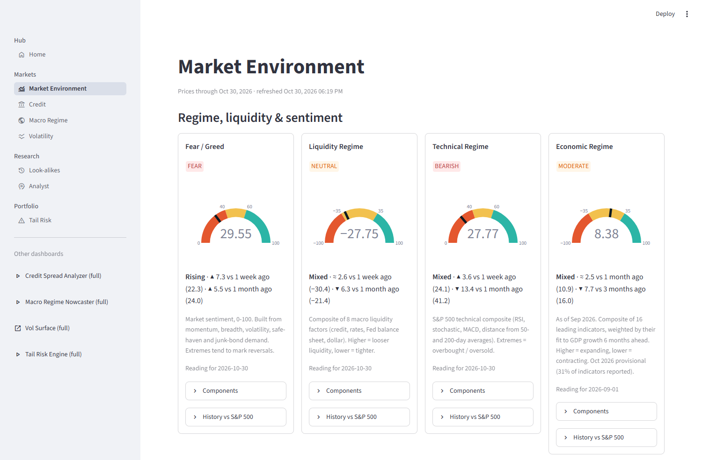

> **Not investment advice.** These are personal research tools. Every page states what its
> numbers have and haven't been shown to do. Most say plainly that the gauges don't
> reliably predict next month's returns.

---

## Contents

- [What's in the hub](#whats-in-the-hub)
- [The companion projects](#the-companion-projects)
- [Quick start (hub only)](#quick-start-hub-only)
- [Full setup with all projects](#full-setup-with-all-projects)
- [Tour of the dashboards](#tour-of-the-dashboards)
- [How it works](#how-it-works)
- [Methodology](#methodology)
- [Configuration](#configuration)
- [Scheduling the nightly refresh](#scheduling-the-nightly-refresh)
- [Adding your own project](#adding-your-own-project)
- [Tests](#tests)
- [Repository layout](#repository-layout)
- [Limitations](#limitations)

---

## What's in the hub

| Page | Needs | What it shows |
|---|---|---|
| **Home** | - | Data freshness for every module, and everything registered with the hub |
| **Market Environment** | this repo | Fear/Greed, Liquidity, Technical and Economic regime gauges, each with a trend, a history chart against the S&P 500 and a measured link to next-period returns. Also S&P 500 breadth, a style/size grid, sector and factor tiles, and an S&P 500 / Nasdaq 100 market map. |
| **Look-alikes** | this repo | The 15 most similar past market states since 1997 and what the S&P 500 did next, with the method's own walk-forward track record |
| **Analyst** | this repo + Anthropic API key | A daily brief written by Claude from the hub's data, and a chat for follow-up questions |
| **Credit** | [credit-spread-analyzer](https://github.com/AndrewFSee/credit-spread-analyzer) | Credit-stress regime, spread forecast, rating tiers, CCC-B decompression, Fed liquidity |
| **Macro Regime** | [macro-regime-nowcaster](https://github.com/AndrewFSee/macro-regime-nowcaster) | Recession probability (point-in-time history since 1967), GDP nowcast, latent macro factors |
| **Volatility** | [stochastic-vol-surface](https://github.com/AndrewFSee/stochastic-vol-surface) | VIX family, implied vol by ticker (skew, term slope, variance risk premium), 21-day vol forecasts |
| **Tail Risk** | [tail-risk-scenario-engine](https://github.com/AndrewFSee/tail-risk-scenario-engine) | 21-day VaR/CVaR from 20,000 simulated paths, hedges, CVaR-optimal weights, stress scenarios |

The first three pages work with this repository alone. Each companion page reads what
its project published. If a project isn't installed, its page says there's no data yet
and the rest of the hub carries on.

## The companion projects

To get the full hub, **clone the four companion repositories next to this one**, each
with its own virtual environment. They are independent projects with their own READMEs,
tests and Streamlit apps. The hub only needs each one's `scripts/publish_to_hub.py`.

| Project | What it adds to the hub | Notes |
|---|---|---|
| [**credit-spread-analyzer**](https://github.com/AndrewFSee/credit-spread-analyzer) | `data/credit/`: spreads (bps and % points), real-time stress-regime probability, overlay equity weight, rating-tier history, 5-day spread forecast | Runs first, because the market gauges use its high-yield spread history. No API key needed. FRED serves only about 3 years of the ICE BofA OAS series; you can splice a longer licensed history in yourself (see that project's README). |
| [**macro-regime-nowcaster**](https://github.com/AndrewFSee/macro-regime-nowcaster) | `data/macro/`: the live nowcast and its walk-forward (point-in-time) recession history | Needs `FRED_API_KEY`. The history panel (`data/features.csv`) isn't in that repo: build it once with `python scripts/build_features.py`, which is slow (one refit per month), then again occasionally. The page warns when it's more than 45 days old. |
| [**stochastic-vol-surface**](https://github.com/AndrewFSee/stochastic-vol-surface) | `data/vol/`: surface features per ticker, VIX/MOVE/OVX history, forecasts with outcomes | Its publisher makes no network calls. It reads what the project's own daily option-chain scraper collected, so run that scraper on a schedule (see its README). The page flags missed sessions. |
| [**tail-risk-scenario-engine**](https://github.com/AndrewFSee/tail-risk-scenario-engine) | `data/tailrisk/`: return fan, P&L histogram, VaR/CVaR, hedges, optimiser, stress scenarios | The portfolio and scenarios come from its `configs/default.yaml` and `configs/scenarios/`. |

## Quick start (hub only)

Developed and tested on Python 3.13.

```bash
git clone https://github.com/AndrewFSee/market-compass.git
cd market-compass
python -m venv .venv
source .venv/bin/activate              # Windows: .venv\Scripts\activate
pip install -r requirements.txt
cp .env.example .env                   # add FRED_API_KEY (free), optionally ANTHROPIC_API_KEY

python run_jobs.py --demo              # synthetic data, no network: see it working right away
streamlit run app.py                   # http://localhost:8501

python run_jobs.py                     # real data
```

`--demo` fills every hub-owned page with synthetic data. The first real run takes a few
minutes. It pulls 5 years of prices for about 500 S&P 500 members and 45 ETFs, full SPY
and VIX history, about 35 FRED series and market caps. Later runs reuse cached market caps
for a week.

## Full setup with all projects

**1. Clone everything into one parent folder.** The hub looks for the projects next to
itself:

```
projects/
├── market-compass/                 <- this repo
├── credit-spread-analyzer/
├── macro-regime-nowcaster/
├── stochastic-vol-surface/
└── tail-risk-scenario-engine/
```

```bash
cd projects
git clone https://github.com/AndrewFSee/market-compass.git
git clone https://github.com/AndrewFSee/credit-spread-analyzer.git
git clone https://github.com/AndrewFSee/macro-regime-nowcaster.git
git clone https://github.com/AndrewFSee/stochastic-vol-surface.git
git clone https://github.com/AndrewFSee/tail-risk-scenario-engine.git
```

A project cloned one level deeper (`macro-regime-nowcaster/macro-regime-nowcaster/`) is
found too. To keep the projects somewhere else, set `HUB_PROJECTS_DIR` to their parent
folder.

**2. Give each project its own `.venv` inside its folder.** The hub runs
`<project>/.venv/Scripts/python.exe` (Windows) or `<project>/.venv/bin/python`, so the
dependencies never mix. Install each one as its README describes:

```bash
cd credit-spread-analyzer    && python -m venv .venv && .venv/bin/pip install -r requirements.txt && cd ..
cd macro-regime-nowcaster    && python -m venv .venv && .venv/bin/pip install -e ".[dev]" && cd ..
cd stochastic-vol-surface    && python -m venv .venv && .venv/bin/pip install -r requirements.lock && .venv/bin/pip install -e . --no-deps && cd ..
cd tail-risk-scenario-engine && python -m venv .venv && .venv/bin/pip install -e ".[app,dev]" && cd ..
```

(On Windows use `.venv\Scripts\pip`.)

**3. Do each project's one-time data setup.** Build the macro panel
(`python scripts/build_features.py` in macro-regime-nowcaster). Run the vol scraper once
and schedule it (`python scripts/schedule_scraper.py --once`; its README covers the
backfills).

**4. Put your keys in the hub's `.env`.** `run_jobs.py` passes its environment on to every
publish script, so one `FRED_API_KEY` serves the hub and the macro project.

**5. Refresh and run:**

```bash
cd market-compass
python run_jobs.py                     # credit -> market -> analogs -> macro -> vol -> tailrisk -> analyst
streamlit run app.py
```

A project that isn't cloned, or has no `.venv`, is skipped with a one-line note instead
of failing the run. `python run_jobs.py --only market credit` runs a subset.

**6. The full apps.** The sidebar's *Other dashboards* links open each project's own
Streamlit app (ports 8502-8505). A link to an app that isn't running starts it with that
project's venv, waits for it and then forwards you. `python start_apps.py` starts the hub
and all four apps at once (`--status`, `--stop`); their logs go to `data/logs/apps/`.

---

## Tour of the dashboards

### Market Environment

**Four regime gauges** (screenshot at the top). Each card shows:

- the reading and its band;
- whether it's rising or falling against 1 week and 1 month ago (1 and 3 months for the
  monthly economic gauge);
- a *Components* table;
- a *History vs S&P 500* chart.

**Gauges vs the S&P 500** measures each gauge two ways:

- How it moves *with* the market: the coincident correlation.
- Whether it says anything about the *next* period: a rank correlation on
  non-overlapping periods, using each reading only from the day it could have been
  published.

The verdict column applies a significance test, and the tabs break next-period returns
down by gauge band. Currently none of the four passes. The page says so rather than
implying a signal.

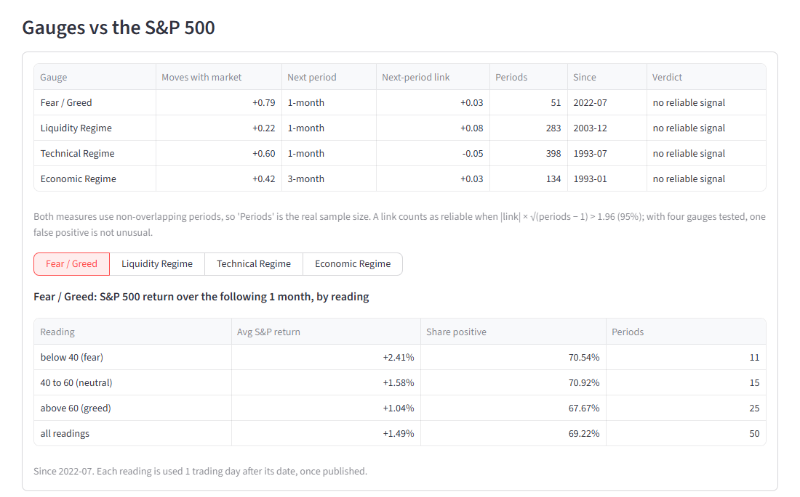

**Breadth, style and sectors.** The breadth panel covers:

- advancing vs declining S&P 500 members, with a cumulative A/D line;
- the share of members above their 20-, 50- and 200-day averages;
- new 52-week highs and lows.

Next to it are a large/mid/small × value/core/growth grid and tiles for the 11 sector ETFs
and 22 factor ETFs. Each tile has 1-day to 2-year returns, coloured as leading, flat or
lagging relative to SPY.

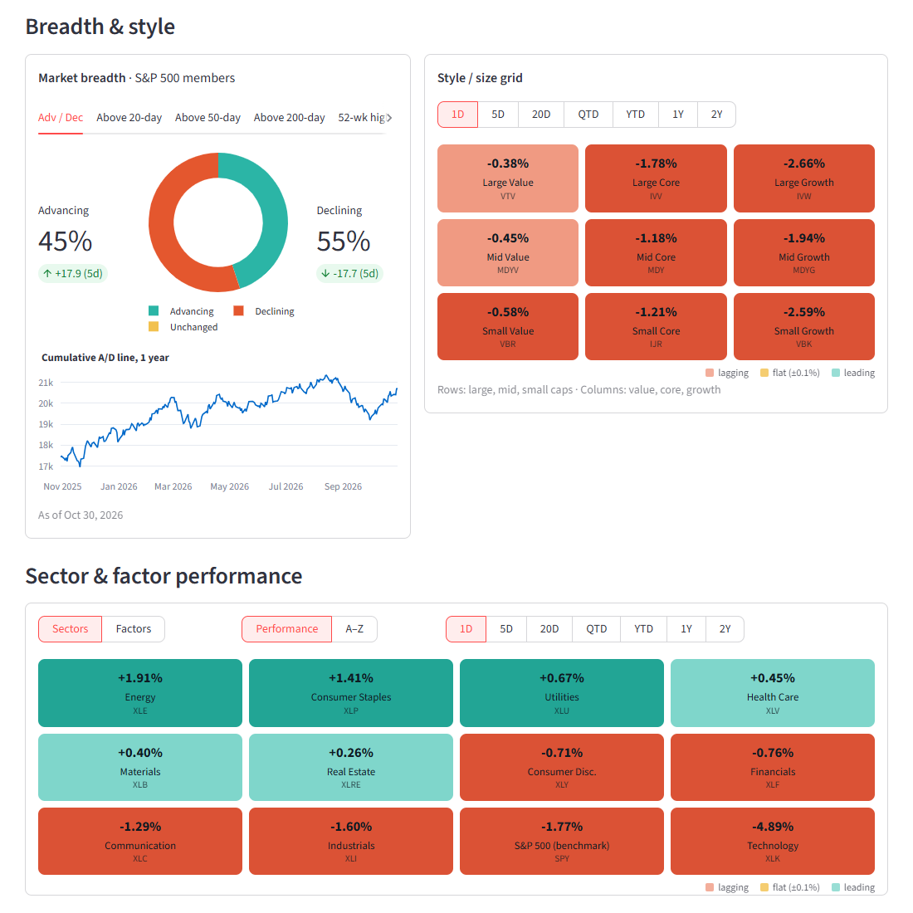

**Market map.** An S&P 500 or Nasdaq 100 treemap, sized by market cap and coloured by
return over the chosen period. Click a sector to zoom in.

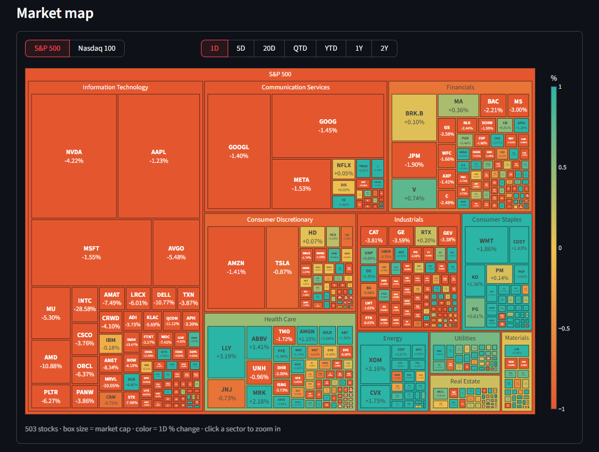

### Credit

From credit-spread-analyzer:

- the real-time credit-stress regime (a 3-state HMM on the Baa spread, refitted each
  January on past data only);
- the equity weight of its validated volatility/credit overlay;
- a 5-day Baa spread forecast;
- the ICE spreads;
- rating-tier percentiles and the CCC-B gap, which widens when the weakest credits crack
  first;
- Fed net liquidity (balance sheet - Treasury General Account - reverse repo).

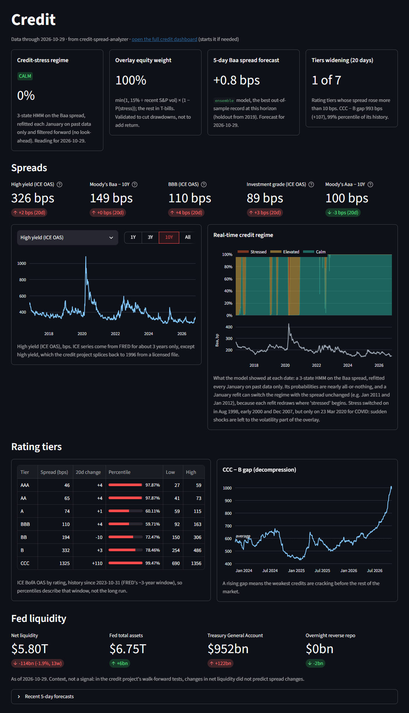

### Macro Regime

From macro-regime-nowcaster:

- the ensemble recession probability, as it read at the time (one refit per month,
  keeping only that fit's final row, so no point uses later data), with NBER recessions
  shaded;
- the signals behind it, with their out-of-sample weights;
- the GDP nowcast with its interval;
- the latest Kalman-filtered factors.

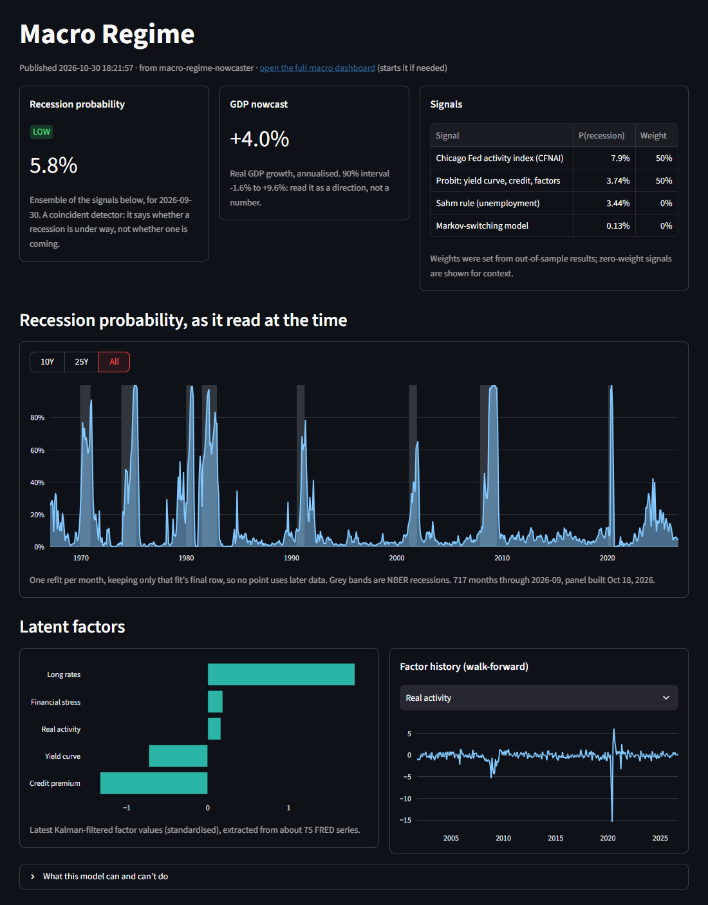

### Volatility

From stochastic-vol-surface:

- the VIX family, MOVE and OVX;
- a table of 30-day ATM implied vol, its 1-year percentile, 25-delta risk reversal,
  30-to-91-day term slope, variance risk premium and the 21-day forecast with an 80% band
  for each ticker;
- implied vs realised vol and the ATM term structure for any ticker.

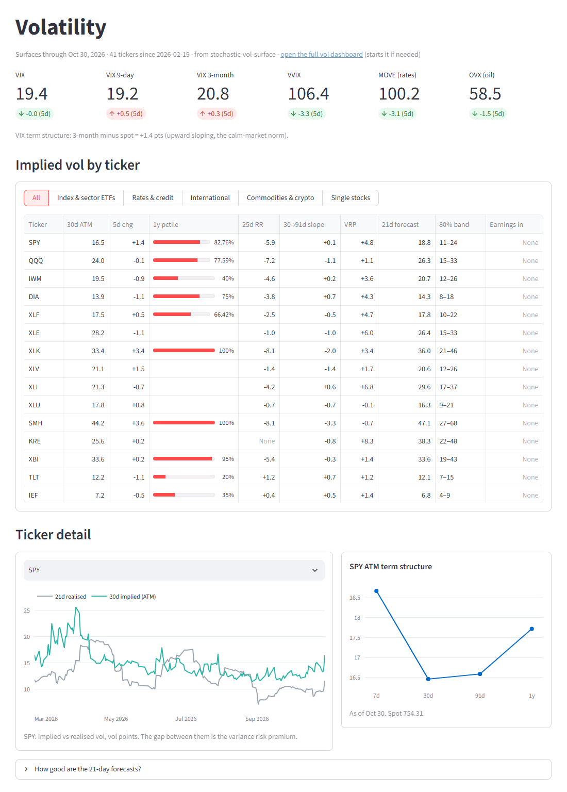

### Look-alikes

The page compares today's market state with every trading day since 1997 and finds the 15
closest distinct episodes. The state covers trend, momentum, VIX, the VIX trend, the
high-yield spread and its change, the liquidity gauge and the yield curve.

It then shows what the S&P 500 did over the following 3 months, against the same
figures for all days. The *Does this method work?* panel holds the walk-forward test:
**no skill on direction** (rank correlation -0.03 over 297 months), but useful for
**volatility** (0.48, adding 0.21 beyond "last month's vol continues").

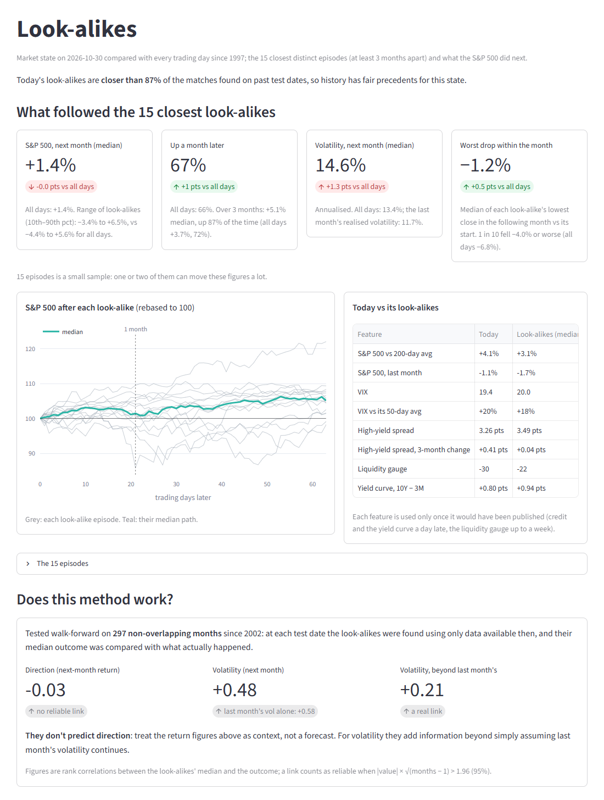

### Analyst

Every evening, after the data refresh, Claude (`claude-opus-5-5`) writes a brief from the
hub's own data. It covers what changed, what stands out, the look-alikes, the risk for the
coming month and what to watch. It calls nine read-only tools over the published data, so
every figure traces back to a page, and the brief notes which inputs are stale.

The page keeps 60 days of briefs. A chat below answers follow-up questions live with the
same tools and shows the tokens each answer used. A brief costs roughly $0.15 to $0.20 in
API usage. Without `ANTHROPIC_API_KEY`, the job is skipped and the rest of the hub is
unaffected.

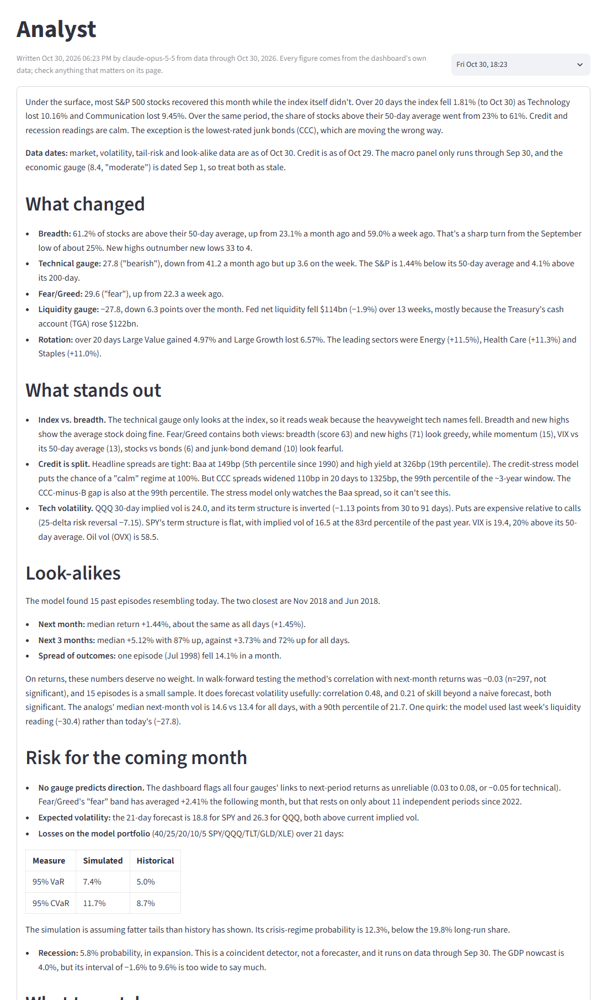

### Tail Risk

From tail-risk-scenario-engine. The engine fits GARCH-t margins and a Student-t copula to
standardized residuals, with a two-state regime model that starts from today's crisis
probability. It simulates 20,000 21-day paths for the configured portfolio.

The page shows:

- VaR and CVaR against the same measures from history;
- the return distribution and path fan;
- hedges (SPY puts priced with Black-Scholes at the current VIX, and an inverse ETF) on
  the same scenarios;
- CVaR-optimal weights;
- historical and parametric stress scenarios.

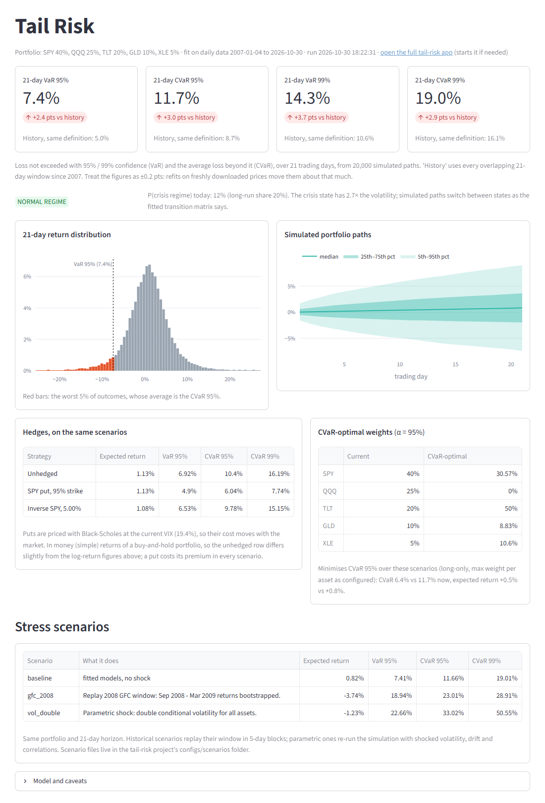

### Home

Data freshness for every module, and everything registered with the hub.

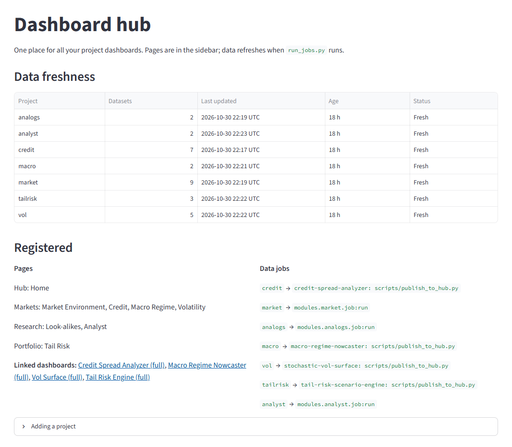

---

## How it works

**Jobs compute, pages display.**

- A *job* fetches data, computes, and saves its results into `data/<module>/` (Parquet
  tables and JSON) with `core.store.save_frame` / `save_json`.
- A *page* only reads them, through a cache keyed on each file's modification time.

So the dashboard loads instantly, a failed refresh leaves the previous numbers in place,
and any page can reuse another module's data. The Analyst chat is the one deliberate
exception: it calls the API from the page.

```
run_jobs.py ──┬─ credit    {credit-spread-analyzer/.venv}  scripts/publish_to_hub.py ─┐
              ├─ market    modules/market/job.py   (FRED, Yahoo, Wikipedia)          │
              ├─ analogs   modules/analogs/job.py  (reads market + credit)           ├──> data/<module>/*.parquet, *.json
              ├─ macro     {macro-regime-nowcaster/.venv}  publish_to_hub.py         │         │
              ├─ vol       {stochastic-vol-surface/.venv}  publish_to_hub.py         │         v
              ├─ tailrisk  {tail-risk-scenario-engine/.venv} publish_to_hub.py       │   app.py (Streamlit) -> pages read only
              └─ analyst   modules/analyst/job.py  (Claude + read-only tools) ───────┘
```

**`registry.py` is the one place to register things.**

- `PAGES`: the sidebar.
- `LINKS`: the full apps, with a launch command each.
- `JOBS`: the refresh, in order.

A job is either `"module:function"`, called in the hub's Python as
`fn(demo=bool, log=callable)`, or `{"cmd": [...], "cwd": ...}`: another project's script,
run with that project's interpreter.

**The publisher contract.** For an external job, `run_jobs.py` sets three things in the
child's environment:

- `HUB_DATA_DIR`, where to write;
- the hub's folder on `PYTHONPATH`, so the child can `from core import store` without the
  hub needing the child's dependencies (or the child the hub's);
- `--demo`, when the hub itself runs with `--demo`.

Publishers stay thin. They call each project's own validated functions and never
re-implement them.

**Operational details:**

- `run_jobs.py` holds `data/jobs.lock`, so a scheduled and a manual refresh can't overlap.
- Each job's output goes to `data/logs/jobs.log`.
- One failing job doesn't stop the others.
- Market prices are cut to the last *complete* session, because Yahoo sometimes serves
  today's row half-filled after the close.

## Methodology

### Regime gauges

All recipes live in `modules/market/config.py` and the pure-pandas
`modules/market/indicators.py`.

| Gauge | Scale | Method |
|---|---|---|
| **Fear / Greed** | 0 to 100 | Six components, each ranked against its trailing 2 years: S&P 500 vs its 125-day average, net new 52-week highs, % of members above their 50-day average, VIX vs its 50-day average (inverted), stocks minus bonds over 20 days, and HY minus IG spread (inverted). |
| **Technical** | 0 to 100 | S&P 500 RSI(14), stochastic(14), MACD histogram, and distance from the 50- and 200-day averages, ranked against the trailing 2 years. |
| **Liquidity** | -100 to +100 | Eight factors, each z-scored against its trailing 3 years and signed so that higher means looser: HY and IG spreads, 3-month change in the 2-year yield, 10-year real yield, Fed net liquidity, bank reserves, the broad dollar, and the Chicago Fed NFCI. |
| **Economic** | -100 to +100 | Sixteen monthly leading indicators. Each one's 6-month change is z-scored and weighted by its historical correlation with real GDP growth 6 months later. The gauge shows the latest month in which at least 75% of the indicators have reported; later months are marked provisional. |

**Trend** compares each reading with 1 week and 1 month ago. **vs S&P 500**:

- *Coincident*: correlation of the gauge's change with the S&P 500's return over the same period.
- *Next period*: Spearman rank correlation between the reading and the following
  1-month (economic: 3-month) return.
  - It uses non-overlapping periods, so the period count is the real sample size.
  - Each reading is used only after its publication lag: 1 day for FRED daily series,
    up to a week for weekly series, a month for monthly data.
  - A link counts as reliable when |ρ|·√(n−1) > 1.96.

**Breadth** uses S&P 500 members as a proxy for the NYSE, because free NYSE-wide
advance/decline data is hard to find.

### Look-alikes

`modules/analogs/engine.py` is pure and fully testable:

- **Features.** Each one is shifted by its publication lag and z-scored using only data up
  to the test date.
- **Matching.** Distance is a weighted RMS across features. Look-alikes must be distinct
  episodes at least 63 trading days apart, and must end 63 days before the test date so
  their outcomes were known.
- **Evaluation.** The method is evaluated walk-forward on non-overlapping months. The
  economic gauge is deliberately left out, because its history uses revised data and
  full-sample weights.

### Analyst

`modules/analyst/tools.py` holds plain functions over the hub store: freshness, market
overview, gauge detail, credit, macro, vol, tail risk, look-alikes and series history.
`agent.py` wraps them for the Anthropic SDK's tool runner. The system prompt asks the
model to cite only tool results, give dates, flag stale inputs and respect the measured
(lack of) predictive power. Server-side refusal fallback is enabled. The tests fake the
client and never call the API.

## Configuration

| Setting | Where | Purpose |
|---|---|---|
| `FRED_API_KEY` | `.env` | FRED API (free key). Without it the market job falls back to the slower keyless CSV endpoint. The macro publisher requires it. |
| `ANTHROPIC_API_KEY` | `.env` | Analyst brief and chat (optional) |
| `HUB_DATA_DIR` | environment | Data folder (default `data/`) |
| `HUB_PROJECTS_DIR` | environment | Parent folder of the companion projects (default: this repo's parent) |
| Tickers, FRED series, gauge recipes, bands, trend windows | `modules/market/config.py` | |
| `CREDIT_OVERRIDE` | `modules/market/config.py` | Use credit-spread-analyzer's spliced HY/IG history in the gauges (on). Falls back to FRED if its table is missing. |
| Look-alike features, weights, lags | `modules/analogs/config.py` | |
| Model, effort, prompts, briefs kept | `modules/analyst/config.py` | |

`.env` is git-ignored. Copy `.env.example` to `.env` to start.

## Scheduling the nightly refresh

Run `run_jobs.py` once each weekday after the close. If you use the vol project, run it
after that project's scraper.

- **Windows:** `powershell -ExecutionPolicy Bypass -File scripts\register_task.ps1`
  registers `\MarketCompass\HubRefresh`:
  - weekdays at 6:15 PM, windowless (`pythonw`);
  - runs whether or not you're logged on;
  - catches up a missed run.

  Task triggers created with a fixed UTC offset fire an hour early once daylight saving
  ends. `scripts\fix_task_timezones.ps1 [-WhatIf]` rewrites them to follow local time.
  Run it from an elevated prompt for tasks set to "run whether user is logged on or not".
- **macOS / Linux (cron):**
  `15 18 * * 1-5 cd /path/to/market-compass && .venv/bin/python run_jobs.py`

The Home page shows how fresh each module's data is.

## Adding your own project

From least to most effort:

1. **Link it.** Add `{"title": ..., "url": "http://localhost:8506", "app": streamlit_app(path, "app.py", 8506)}`
   to `LINKS`. It stays a separate app with a sidebar link that starts it on demand.
2. **Mount it as a page.** Add its script to `PAGES` with an absolute path and remove its
   `st.set_page_config(...)` call (the hub sets it once).
3. **Split it into a job and a page** (what the four companions do). Write a publish script
   that ends with `store.save_frame("<module>", "<name>", df)` and register it in `JOBS` as
   `{"cmd": [venv_python(path), "scripts/publish_to_hub.py"], "cwd": str(path)}`. Then add
   `modules/<name>/page.py`, which only reads with `store.load_frame`. You get one
   scheduled refresh for everything, and other pages, including the Analyst, can use the
   data.

A hub-native module goes under `modules/<name>/` with `config.py`, `job.py`, `page.py`
(and a pure `indicators.py` or `engine.py` for calculations). Any new input also needs a
synthetic version so `--demo` and the tests keep working offline.

## Tests

```bash
python -m pytest -q
```

The tests run the whole hub pipeline on synthetic data and render every page headlessly
with Streamlit's `AppTest`. Each companion page is fed a fake in its publisher's schema.
They also cover the gauge and statistics maths, the look-alike engine, the analyst (with a
fake client), the app launcher, skipping missing projects, and module reloading. They need
no network and no API keys.

## Repository layout

```
app.py                  Hub entry point: navigation from registry.py, launcher links
registry.py             The one place to register pages, linked apps and data jobs
run_jobs.py             Refreshes every registered job (lock, logs, skips missing projects)
start_apps.py           Starts/stops the hub and the companion apps (--status, --stop)
core/
  store.py              Shared data folder: save_frame / load_frame / save_json / load_json
  ui.py                 Gauges, donuts, tiles, Streamlit-version shims
  apps.py               Start and check linked apps (used by the launcher and start_apps)
  env.py                Loads .env
views/
  home.py               Data freshness and registry overview
  launch.py             Hidden page: starts a linked app if needed, then forwards to it
modules/
  market/               config, sources (network), indicators (pure), job, page, demo
  analogs/              config, engine (pure), job, page
  analyst/              config, tools (read-only), agent (SDK tool runner), job, page
  credit/ macro/ vol/ tailrisk/
                        config + read-only page for each companion project's output
scripts/
  register_task.ps1     Windows scheduled task for the nightly refresh
  fix_task_timezones.ps1  Make scheduled tasks follow local time across DST
tests/test_smoke.py     End-to-end tests on synthetic data
docs/screenshots/       Images in this README
```

## Limitations

- **The gauges describe the market; they don't forecast it.** None currently shows a
  reliable link to next-period S&P 500 returns, and the page says so.
- **Calibration.** The liquidity gauge never reached its "loose" band in five years of
  history. The technical gauge ranks against the trailing 2 years, so ordinary pullbacks
  after a strong run can read "bearish". Both are open calibration items.
- **Proxies.** Breadth uses S&P 500 members, not the whole NYSE. There's no put/call
  component.
- **Free data.** Yahoo Finance and Wikipedia can change without notice. FRED serves only
  about 3 years of the ICE OAS series.
- **Platform.** Developed and run on Windows 11. The hub, jobs and tests are
  cross-platform, but the scheduling scripts and `start_apps.py --stop` are
  Windows-specific.

Data: [FRED](https://fred.stlouisfed.org/) (Federal Reserve Bank of St. Louis), Yahoo
Finance via [`yfinance`](https://github.com/ranaroussi/yfinance), Wikipedia (index
membership), and the companion projects' own sources.

## License

[MIT](LICENSE). The companion projects carry their own licenses.
